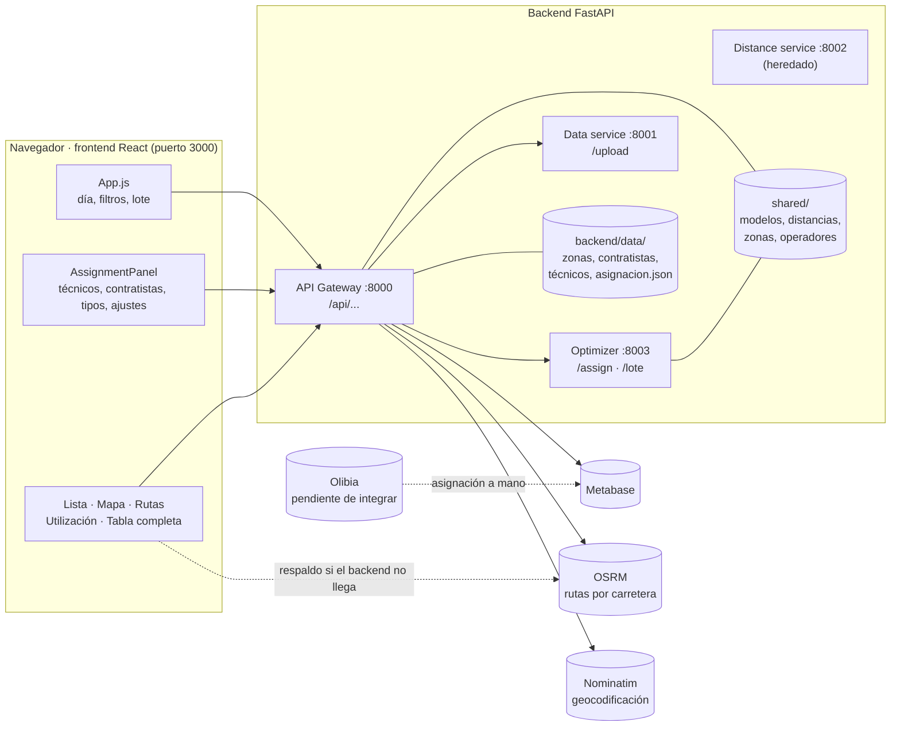
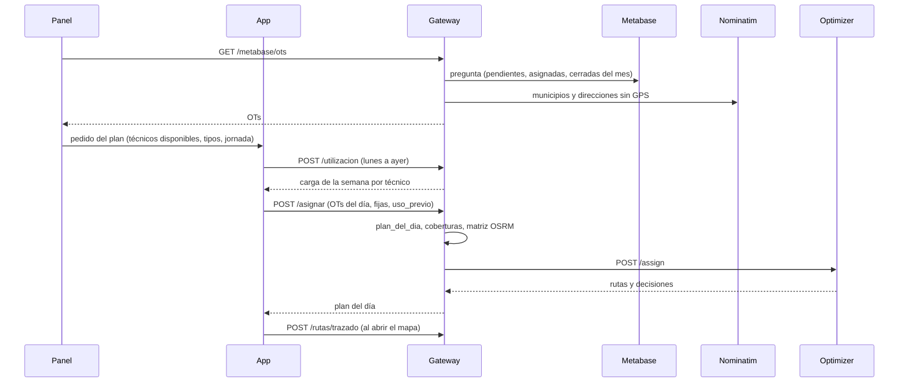
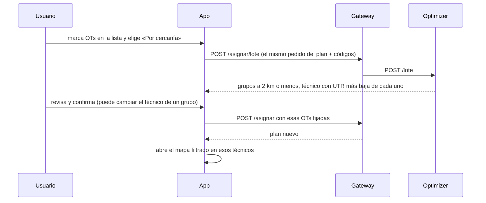

# Arquitectura de Ruteo

Cómo se conectan el frontend (la pantalla) y el backend (los servicios), qué hace cada pieza y por dónde pasa una OT desde Metabase hasta el plan del día.

## Vista general

- El **frontend** solo habla con el **API Gateway** (`http://localhost:8000/api`, o `REACT_APP_API_URL`). La única excepción es OSRM: si el backend no llega, el navegador pide directo los tiempos y el trazado por carretera (`services/osrm.js`).
- El **API Gateway** lee Metabase, ubica las OTs, arma el plan del día y le pide al **Optimizer** que decida. También calcula la utilización (UTR) y traza las rutas.
- El **Optimizer** es el motor: reparte las OTs entre cuadrillas de técnicos (OR-Tools) y contratistas.
- **Olibia** todavía no está conectada: la asignación se hace a mano en Olibia y vuelve a Ruteo a través de Metabase.

## Cómo se arranca

`./iniciar.sh` en la raíz:

1. Crea `backend/.venv` e instala `requirements.txt` (solo la primera vez).
2. Crea `backend/.env` desde `.env.example` si no existe.
3. Levanta los 4 servicios con uvicorn: data `8001`, distance `8002`, optimizer `8003` y gateway `8000` (registros en `logs/`).
4. Espera a que el gateway responda en `/api/health` y avisa si Metabase no está configurado.
5. Arranca el frontend con `npm start` (puerto 3000).

`docker-compose.yml` levanta lo mismo en contenedores, más Redis, que solo usa el distance service heredado como caché.

## Backend

### API Gateway (`backend/api_gateway`, puerto 8000)

| Módulo | Qué hace |
|---|---|
| `main.py` | Crea la app, CORS, y monta los routers bajo `/api` |
| `assignment_routes.py` | Endpoints del plan: Metabase, catálogo, configuración, `/asignar`, `/asignar/lote`, trazado. Aquí está `plan_del_dia` (qué OTs entran el día elegido y a quién quedan fijadas) y el reconocimiento de técnicos por nombre (`responsables`, `tecnicos_mencionados`) |
| `metabase.py` | Llama a la pregunta de Metabase y convierte cada fila en una OT (`filas_a_actividades`). `ALIAS_COLUMNAS` define qué nombres de columna reconoce: situación, fecha, electricistas, creado por, etc. |
| `geocoding.py` | Ubica las OTs sin GPS con Nominatim: municipio enseguida, dirección en segundo plano, con caché en `data/geocache.json` |
| `trazado.py` | Habla con OSRM: matriz de tiempos por carretera (`matriz_vial`) y trazado de cada ruta (`trazar`), con servidor de respaldo y caché |
| `utilizacion.py` | `/utilizacion`: horas usadas por técnico y día frente a las disponibles (UTR) |
| `routes.py`, `orchestrator.py` | Endpoints heredados del optimizador original (`/upload`, `/optimize`…); de ellos la pantalla usa solo `/upload` |

### Optimizer (`backend/services/optimizer_service`, puerto 8003)

| Endpoint | Función | Qué hace |
|---|---|---|
| `POST /assign` | `assignment.asignar` | Decide a quién va cada OT del día y arma las rutas |
| `POST /lote` | `assignment.repartir_lote` | Propuesta para varias OTs elegidas: grupos por cercanía, cada uno al técnico con la UTR más baja |

Cómo decide `asignar`:

1. Separa las OTs **externas** (su responsable no está en la app) y las **sin ubicación**.
2. Respeta las **fijadas**: asignadas en Metabase a un técnico disponible o a un contratista del catálogo, y las ediciones a mano.
3. Cada OT libre va al **equipo Bia** que cubre su OR y su zona (`data/zonas_bia.json`); si ningún equipo la cubre, a contratistas.
4. Arma **cuadrillas** de 1 o 2 personas según lo que piden las OTs (`armar_cuadrillas`). Un técnico con una OT fijada de 2 personas no sale solo.
5. Junta las OTs libres que están a **2 km o menos** entre sí (`grupos_cercanos`, `radio_grupo_km`): viajan como un solo punto, así las hace una sola cuadrilla. Si un grupo no cabe en ninguna jornada, se separa y se vuelve a resolver.
6. Resuelve un **VRP con OR-Tools** (`_resolver_vrp`): varias bases, jornada como tope, tiempos por carretera con tránsito y duración por tipo de OT.
7. Lo **reparte parejo** (`_resolver_balanceado`): con la carga de la semana de cada técnico (`uso_previo`), le da más a quien lleva menos; lo que sobra va primero al siguiente con menos carga.
8. Lo que no cabe en los técnicos va al **contratista más cercano de su OR** (`_asignar_contratistas`).
9. Devuelve rutas, una **decisión por OT** con su motivo, y métricas.

### Data service (puerto 8001) y Distance service (puerto 8002)

- **Data service**: `POST /upload` lee un Excel o CSV de OTs (botón «o subir un Excel/CSV» en Ajustes).
- **Distance service**: viene del optimizador original. El plan actual no lo llama: las distancias se calculan dentro del gateway y del optimizer con `shared/distancias.py`.

### Código compartido (`backend/shared`)

| Archivo | Qué contiene |
|---|---|
| `models.py` | Modelos Pydantic: `Activity` (una OT), `Tecnico`, `SedeOperativa`, `JornadaConfig`, `AssignmentRequest`, `AssignmentResult`, `DecisionOT`… Es el contrato entre gateway y optimizer |
| `distancias.py` | Km y minutos entre dos puntos: matriz de OSRM si existe; si no, línea recta × factor vial. Suma el recargo de tránsito de la zona |
| `zonas.py` | Zonas de los equipos Bia y de tránsito; si una OT está en una zona |
| `operadores.py` | Catálogo de OR (Enel, Air-e, Afinia…) y sus nombres alternativos |
| `catalogo.py` | Bases Bia y sedes de contratistas desde `data/contratistas.csv` o la hoja publicada |
| `config.py` | Variables de `backend/.env` |

### Datos y configuración

| Archivo | Qué guarda | Se edita |
|---|---|---|
| `backend/.env` | Metabase (URL, API key, pregunta), OSRM, geocodificación | A mano; no se sube al repositorio |
| `data/asignacion.json` | Técnicos, contratistas por OR, minutos y personas por tipo de OT | Desde la app (`PUT /api/asignacion/config`) |
| `data/zonas_bia.json` | OR y zonas que cubre cada equipo; recargo de tránsito por ciudad | A mano |
| `data/contratistas.csv` | Bases y sedes de contratistas (sin datos de contacto) | A mano o desde la hoja |
| `data/tecnicos.csv` | Técnicos de la hoja, para cargarlos la primera vez | A mano |
| `data/operadores_red.csv` | OR de Colombia y sus departamentos | A mano |
| `data/geocache.json` | Caché de direcciones ya ubicadas | Solo |

## Frontend (`frontend/src`)

| Archivo | Qué hace |
|---|---|
| `App.js` | Estado de la pantalla: día del plan (y el cambio solo a medianoche), filtros, cuadros, ediciones a mano (`fijas`), selección y asignación por lote. Llama a `/asignar` con la carga de la semana para el reparto parejo |
| `components/AssignmentPanel.jsx` | Panel izquierdo: técnicos por equipo y disponibilidad, contratistas por OR, tipos de OT y ajustes. Trae las OTs de Metabase, se actualiza solo y arma el pedido del plan |
| `components/AssignmentResults.jsx` | Cuadros que filtran, lista de decisiones con el lápiz para editar y casillas para el lote, «Falta por asignar» y rutas |
| `components/AssignmentMapView.jsx` | Mapa Leaflet: bases, OTs y rutas por carretera |
| `components/UtilizationDashboard.jsx` | Utilización por técnico, por día, semana o mes |
| `components/LoteBar.jsx` | Barra de las OTs seleccionadas: a un técnico, a un contratista o por cercanía |
| `components/LoteModal.jsx` | Propuesta por cercanía: grupos y técnico de cada uno, editable |
| `components/OtsTable.jsx` | Tabla completa con todas las columnas de la pregunta |
| `components/TechniciansModal.jsx`, `OrContractorsModal.jsx`, `OtTypesModal.jsx` | Ventanas para editar técnicos, contratistas por OR y tipos de OT |
| `services/api.js` | Todas las llamadas al gateway |
| `services/osrm.js` | OSRM desde el navegador, de respaldo |
| `services/otTypes.js` | Minutos y personas por defecto de cada tipo de OT |

## Endpoints y quién los usa

| Endpoint | Qué hace | Lo usa | Llama a |
|---|---|---|---|
| `GET /api/metabase/estado` | Si Metabase está configurado y la pregunta guardada | Panel | — |
| `GET /api/metabase/ots` | Trae las OTs de la pregunta y ubica las que no tienen GPS | Panel (Extraer y recomendar, actualización automática) | Metabase, Nominatim |
| `POST /api/upload` | Lee un Excel/CSV de OTs | Panel (Ajustes) | Data service |
| `GET /api/catalogo` | Bases Bia y sedes de contratistas | App | — |
| `GET /api/operadores` | OR del catálogo para los nombres que traen las OTs | Panel | — |
| `GET /api/zonas` | Equipos con sus zonas y tránsito por ciudad | App (y se los pasa al panel) | — |
| `GET /api/tecnicos/hoja` | Técnicos de la hoja; el panel avisa cuáles faltan en la app | Panel | — |
| `GET/PUT /api/asignacion/config` | Técnicos, contratistas por OR, tipos de OT | Panel y sus ventanas | — |
| `POST /api/asignar` | Plan del día | App (cada cálculo, cambio de día o edición) | OSRM, Optimizer `/assign` |
| `POST /api/asignar/lote` | Propuesta por cercanía para las OTs seleccionadas | App (barra del lote) | OSRM, Optimizer `/lote` |
| `POST /api/utilizacion` | UTR por técnico y día | App (carga de la semana), Utilización | — |
| `POST /api/rutas/trazado` | Geometría de cada ruta por carretera | Mapa | OSRM |
| `GET /api/rutas/estado` | Si el backend llega a OSRM | Diagnóstico | OSRM |

Heredados, sin uso en la pantalla actual: `/api/optimize`, `/api/estimate-crews`, `/api/geographic-summary`, `/api/analyze-proximity`, `/api/optimize-by-clusters`, `/api/info`.

## Flujos

### Extraer y recomendar

Al abrir la app, cada 10 minutos y al empezar un nuevo día el panel repite este flujo solo (`Actualizar cada N min`).

### Asignar varias OTs por cercanía

Con un técnico o contratista concreto en la barra no hay propuesta: las OTs quedan fijadas a ese destino y se recalcula el plan.

### De la asignación en Olibia de vuelta a Ruteo

1. En Ruteo se revisa el plan y se asigna en **Olibia** (a mano por ahora).
2. Metabase refleja la asignación (qué tan rápido depende de cómo esté conectado a la base de Olibia): la OT pasa a *Asignada* con su técnico.
3. En la siguiente actualización Ruteo la trae como asignada y la fija a ese técnico.

Para que Ruteo asigne directo en Olibia hace falta la petición que hace Olibia al asignar (Copy as cURL, sin el token) y un usuario de servicio en `backend/.env`.

## Dónde tocar para…

| Cambio | Dónde |
|---|---|
| Una columna nueva de Metabase | La pregunta (SQL en el README) y `ALIAS_COLUMNAS` en `api_gateway/metabase.py`; el campo en `Activity` (`shared/models.py`) |
| Duración o personas de un tipo de OT | En la app: *Tipos de OT*; los valores por defecto en `frontend/src/services/otTypes.js` |
| Qué cubre cada equipo o el tránsito | `backend/data/zonas_bia.json` |
| La distancia para juntar OTs | En la app: *Ajustes → Jornada → Juntar OTs a (km)* (`radio_grupo_km`) |
| Cómo decide el motor | `backend/services/optimizer_service/assignment.py` |
| Qué OTs entran en el plan de un día | `plan_del_dia` en `api_gateway/assignment_routes.py` y `entraEnElDia` en `frontend/src/App.js` |
